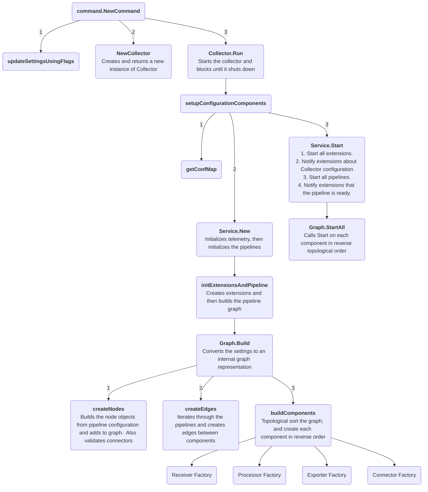
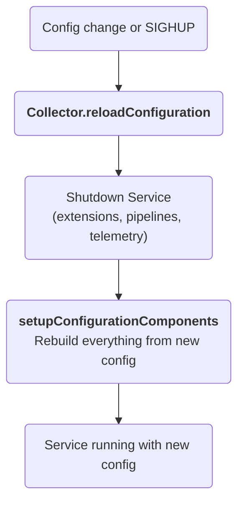
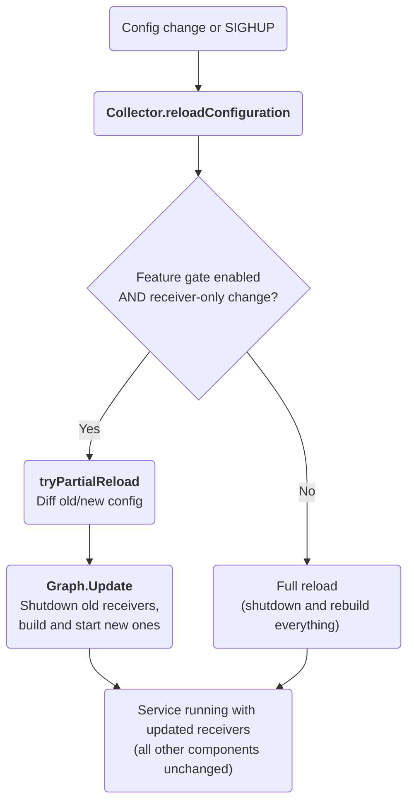

## Internal architecture

This document describes the Collector internal architecture and startup flow. It can be helpful if you are starting to contribute to the Collector codebase.

For the end-user focused architecture document, please see the [opentelemetry.io's Architecture documentation](https://opentelemetry.io/docs/collector/architecture/).  While it is end user focused, it's still a good place to start if you're trying to learn about the Collector codebase.

### Startup Diagram

### Configuration Reload

The Collector supports reloading its configuration at runtime, triggered by a file system change event from a config provider or a `SIGHUP` signal. The reload is handled by `Collector.reloadConfiguration`, which by default performs a **full reload**: the entire `Service` (extensions, pipelines, telemetry) is shut down and rebuilt from scratch using the new configuration. This is simple and correct, but it disrupts all components — processors lose in-flight data, exporter queues are drained, and extensions are restarted — even when only a small part of the config changed.

#### Partial Receiver Reload (Alpha)

When the `service.partialReload` (Alpha) and `service.partialReloadReceivers` (Beta, on by default) feature gates are both enabled (`--feature-gates=service.partialReload`), the Collector first checks whether the config change is limited to receivers. If only receiver configurations and/or pure-receiver entries in pipeline receiver lists have changed — and all other sections (processors, unless the processor gate is on, exporters, connectors, extensions, telemetry, pipeline structure) are identical — a partial reload is performed instead. (With `service.partialReloadProcessors` also enabled, processor changes are handled together with receiver changes; see below.)

The partial reload path (`Collector.tryPartialReload`) delegates to `Graph.Update` (see the processor section below for the combined algorithm). For receivers alone it does the following:

1. **Collect** all current receiver nodes from pipelines (skipping connectors-as-receivers)
2. **Determine** the desired receiver set from the new pipeline configs
3. **Categorize** receivers into add, remove, and rebuild sets
4. **Shutdown** receivers that are being removed or rebuilt
5. **Remove** old receiver nodes and edges from the graph
6. **Create** new receiver nodes for added and rebuilt receivers
7. **Wire** edges from new receiver nodes to existing downstream capabilities nodes
8. **Build** new receiver components via their factories
9. **Start** new receivers

Processors, exporters, connectors, and extensions remain running and untouched throughout. If the config change affects anything beyond receivers, the partial reload is skipped and the standard full reload executes.

#### Partial Processor Reload (Beta)

When the `service.partialReload` and `service.partialReloadProcessors` (Beta, on by default) feature gates are enabled (in practice, once `service.partialReload` is enabled), processors are also eligible for partial reload. Receivers and processors are handled together: `Collector.tryPartialReload` calls `partialReloadSupported`, which allows receiver differences only when the receiver gate is enabled and processor differences only when the processor gate is enabled. Exporters, connectors, extensions, telemetry, and the set of pipelines with their exporters and connector-as-receiver entries must be identical, otherwise the standard full reload runs.

All the receiver and processor changes are applied in one pass by `Graph.Update`, which works out what needs to restart so that each component is shut down, rebuilt, and started at most once. The restart set is:

- Receivers that were added or removed, whose config changed, or whose pipeline membership changed (as in the receiver phase).
- For each pipeline whose processor list differs, or that uses a processor whose config changed: the changed processors, every processor upstream of them, and all of the pipeline's receivers. Every component stores the next consumer it was built with, so everything upstream of a replaced component must be recreated. The longest run of unchanged processors at the end of the pipeline keeps running, since those only reference the pipeline's fan-out node.

Exporters, connectors, and pipelines that are not affected are not restarted. The pass runs in this order:

1. **Identify** the affected pipelines and processors, then categorize receivers into add, remove, and rebuild (a receiver in an affected pipeline is rebuilt)
2. **Shutdown** the receivers being removed or rebuilt, then the processors being replaced
3. **Update the graph**: remove the old receiver nodes, replace the processor nodes, create the new receiver nodes, and rewire the edges
4. **Build** the new processors from last to first, then the pipelines' capabilities consumers, then the receivers
5. **Start** the new processors from last to first, then the receivers

Receivers are keyed by signal and component ID, so a receiver shared with a pipeline that is not affected is restarted too; that pipeline's processors and exporters keep running. If a pipeline with processor changes is fed by a connector, the connector holds a reference to the pipeline's capabilities node, so `Graph.Update` makes no change and reports that a full reload is required. As with receivers, if a partial reload fails part way, the service falls back to a full reload.

### Where to start to read the code
Here is a brief list of useful and/or important files and interfaces that you may find valuable to glance through.
Most of these have package-level documentation and function/struct-level comments that help explain the Collector!

- [collector.go](../otelcol/collector.go)
- [graph.go](../service/internal/graph/graph.go)
- [component.go](../component/component.go)

#### Factories
Each component type contains a `Factory` interface along with its corresponding `NewFactory` function.
Implementations of new components use this `NewFactory` function in their implementation to register key functions with
the Collector.  An example of this is in [receiver.go](../receiver/receiver.go).

For example, the Collector uses this interface to give receivers a handle to a `nextConsumer` -
which represents where the receiver will send its data next in its telemetry pipeline.
