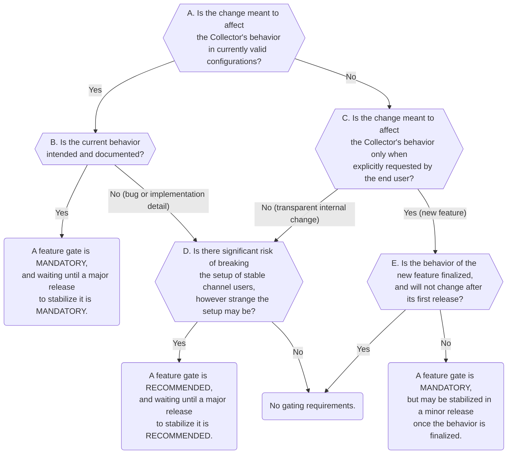

# Making the Collector stable by default

This RFC addresses issue [#14064](https://github.com/open-telemetry/opentelemetry-collector/issues/14064).

**Contents**
1. [Problem statement](#problem-statement)
2. [Scope](#scope)
   1. [What will be stable](#what-will-be-stable)
   2. [Where will it be stable](#where-will-it-be-stable)
3. [Proposed solution](#proposed-solution)
   1. [OCB changes](#ocb-changes)
   2. [Collector CLI changes](#collector-cli-changes)
   3. [Policy changes](#policy-changes)
   4. [Other changes](#other-changes)

## Problem statement

Feedback that the Collector SIG has received over the years,
[especially as part of the graduation process for the OpenTelemetry project](https://github.com/cncf/toc/issues/1739#issuecomment-3386269224),
has shown that we must place greater importance on the stability of the Collector,
especially [as we approach the release of version 1](core-distro-v1.md) of the Core and OTLP distributions.

This must of course include the stability of Collector APIs as part of semantic versioning,
but also the stability of the Collector's _behavior_ as experienced by end users.

Development is too active to completely freeze the Collector's behavior,
and it is impossible to get every new feature right on the first try,
leading to potentially breaking changes.
This means that to avoid bad surprises, we must draw a distinction between
features we guarantee the stability of, and those which remain experimental.

This distinction must be crystal clear to end users.
We believe that the best way to accomplish this is to make such experimental features _opt-in_.

On the other hand, making experimental features opt-in comes with a risk of too few users trying them,
which prevents contributors from getting the very feedback which would determine when the feature is ready to be considered stable.

Thus, we would like incentivize users with lesser stability requirements to enable more experimental features by packaging them together:
in other words, provide a simple way to experiment with the future state of the Collector,
instead of enabling experimental features on a case-by-case basis,
as is currently the case with feature gates.

## Scope

### What will be stable

We distinguish two broad scopes of Collector features:
- Collector components;
- individual features of components.

Collector components [have a concept of stability](../component-stability.md), with the following levels:

| Level        |
|--------------|
| Development  |
| Alpha        |
| Beta         |
| Stable       |
| Deprecated   |
| Unmaintained |

Currently, components of all stability levels are available to end users
as long as they are included in a distribution of the Collector.

Stability levels are specified per-signal. This means:
- Extensions have a single stability level;
- Receivers, processors, and exporters have one stability level per signal;
- Connectors have one stability level per pair of input and output signals.

New features within a component are often controlled by a [feature gate](../../featuregate/README.md), with the following stages:

| Level      | Default | Configurable |
|------------|---------|--------------|
| Alpha      | Off     | Yes          |
| Beta       | On      | Yes          |
| Stable     | On      | No           |
| Deprecated | Off     | No           |

The life cycle of a component or feature gate usually goes through the levels in order,
with the exception of "Deprecated" and "Unmaintained", which are separate from the rest of the stability ladder
(cf. [the component stability reference document](../component-stability.md#moving-between-stability-levels)).

### Where will it be stable

The mechanisms for controlling stability will be built into the Collector service,
the Collector builder (OCB), and `mdatagen`.

However, the ultimate decision on which stability level to guarantee by default will be left to distribution maintainers.

We aim to make the Core and OTLP distributions default to stable features only as part of their v1 release.
Other distributions maintained by the Collector SIG may follow suit, but this is left as a future decision.

## Proposed solution

### OCB changes

We propose that OCB introduce a new optional `dist::default_stability` section to its distribution manifest format,
with the following default values:

```yaml
dist:
  default_stability:
    components: development
    feature_gates: beta    
```

#### Component stability

`dist::default_stability::components` specifies the minimum stability level that a component must declare
in order to be instantiable in this distribution by default.

The valid values will be `development`, `alpha`, `beta`, and `stable`.

In this context, a component will be considered "instantiated" when:
- the `service` section of the Collector config references its config,
  either in a pipeline or in `extensions`;
- a component creates instances of another component programmatically
  (e.g. receiver instances created by the
  [receiver_creator](https://github.com/open-telemetry/opentelemetry-collector-contrib/blob/main/receiver/receivercreator/README.md)).

Stability levels are compared as `Development` < `Alpha` < `Beta` < `Stable`.

In principle, the `Deprecated` and `Unmaintained` statuses are orthogonal to stability,
but the stability levels do not reflect this, and can no longer easily be changed,
as the `component` Go API is now stable.

To avoid immediately making a previously `Stable` components unavailable by default
in the first distro release which marks it as `Deprecated`,
we take the conservative approach of always enabling `Deprecated` and `Unmaintained` components,
as is the current status quo.

This could lead to bizarre situations where a `Development` component which has been abandoned
suddenly becomes available by default,
but paired with visible warnings in logs from the use of a deprecated components,
we deem this an acceptable compromise.

OCB's generated code would pass this field to the `otelcol` runtime package
via a new field in `otelcol.CollectorSettings`.

#### Feature gate stability

`dist::default_stability::feature_gates` will specify the minimum stage that a feature gate must declare
in order to be enabled by default.

Currently, `alpha` feature gates can only be enabled on a case-by-case basis.
For this reason, they are necessarily sometimes used as a form of configuration,
meant to be enabled only in certain circumstances.
They are not necessarily meant to represent "the future defaults of the Collector",
and enabling all of them at once could have unpredictable consequences.

Additionally, `deprecated` feature gates simply cannot be enabled by end users currently.

As such, we choose to exclude both values for this field:
the only valid values will be `beta` and `stable`.

OCB's generated code would pass this field to the `otelcol` runtime package
via a new field in `otelcol.CollectorSettings`.

### Collector CLI changes

We propose that the Collector binary take a new optional command-line flag,
which allows relaxing or tightening the above defaults:

| Flag                    | Min component stability | Min feature gate stage |
|-------------------------|-------------------------|------------------------|
| `--channel=stable`      | Stable                  | Stable                 |
| `--channel=beta`        | Beta                    | Beta                   |
| `--channel=alpha`       | Alpha                   | Beta                   |
| `--channel=development` | Development             | Beta                   |

A single flag is used for both components and feature flags,
in order to keep Collector configuration as simple as possible.

When the minimum feature gate stage is set to `stable`,
whether that be through the distribution defaults or through the above flag,
specifying `--feature-gates` will lead to an error on startup.

This is to further incentivize the use of the "bundled" beta release channel,
instead of cherry-picking Beta feature gates on top of a stable baseline.

When the release channel is set to beta or below however,
enabling alpha feature gates (for further experimentation)
and disabling beta feature gates (as a workaround if they cause issues)
would still be available in the usual way.

Concretely, the implementation would involve changes in:
- the `otelcol` package to introduce the CLI flag;
- the `service` package to enforce the provided component stability level;
- the `featuregate` package to implement the "stable-only" feature gate mode.

### Policy changes

To make these changes useful, this RFC proposes some changes to
(or clarifications of) our coding guidelines and stability policy,
which maintainers will need to enforce.

Specifically, we propose implementing restrictions on:
- when changes to the Collector should be gated by a feature gate;
- and when those feature gates should be migrated to the Stable stage;

depending on the type of change and possible risk, as evaluated by Collector maintainers.



Additional changes:

- For Collector distributions maintained by the Collector SIG,
  upgrade of a component to a new major release
  MUST also correspond to a major release of the distribution
  to make adoption breaking changes more visible to end users.

- While the Collector service will enforce stability requirements for service-instantiated components,
  it is the responsibility of a component to enforce them for programatically instantiated subcomponents
  (e.g. receiver instances created by the
  [receiver_creator](https://github.com/open-telemetry/opentelemetry-collector-contrib/blob/main/receiver/receivercreator/README.md)).

  Alternatively (or while waiting for an API which exposes the requisite information),
  such components will be restricted to the minimum stability level of their subcomponents.

- Optional features which are not meant to become the default,
  but which are finalized and ready to be widely available,
  SHOULD not be solely controlled by an Alpha feature gate.
  
  Contributors should use a YAML config option in the general case,
  or a CLI flag in rare cases where that isn't possible.
  
  As listed in the decision tree, a feature gate MAY be used
  _in addition_ to mark the option as experimental.

### Other changes

To apply the last policy change, maintainers and code owners will need to find
cases of Alpha feature gates which gate "stable" behavior changes,
and replace them by either a YAML config option, or a new CLI flag if not possible.

A known example of the latter is [`confmap.enableMergeAppendOption`](https://github.com/open-telemetry/opentelemetry-collector/blob/main/confmap/internal/metadata/generated_feature_gates.go),
which controls fundamental config parsing behavior, and thus cannot be implemented as a config option.

This migration need not be completed before the distribution is marked stable;
the option will simply be considered "experimental" until it is migrated.
