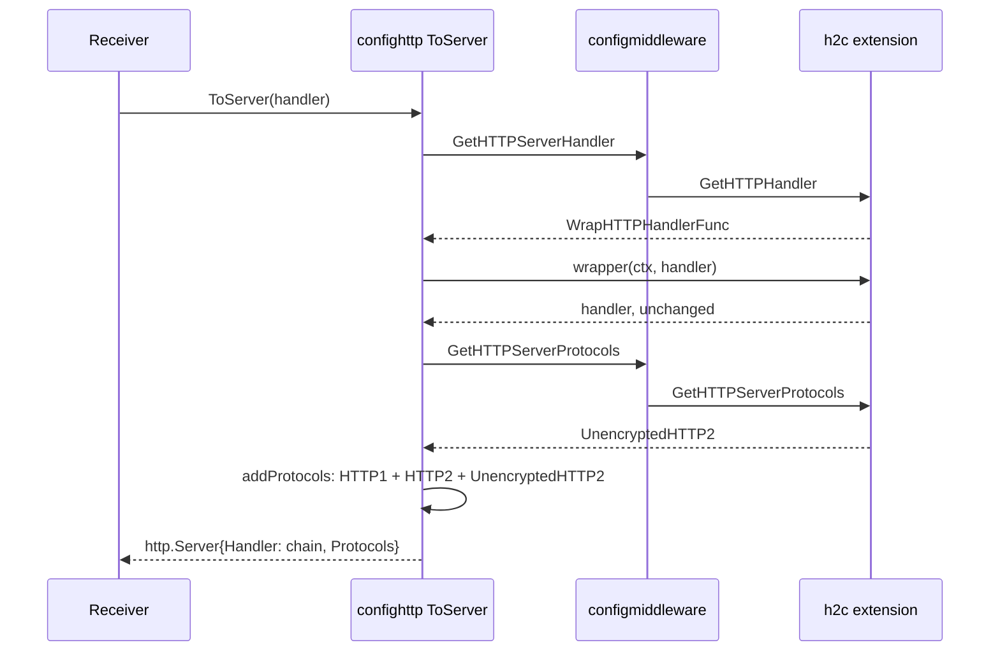
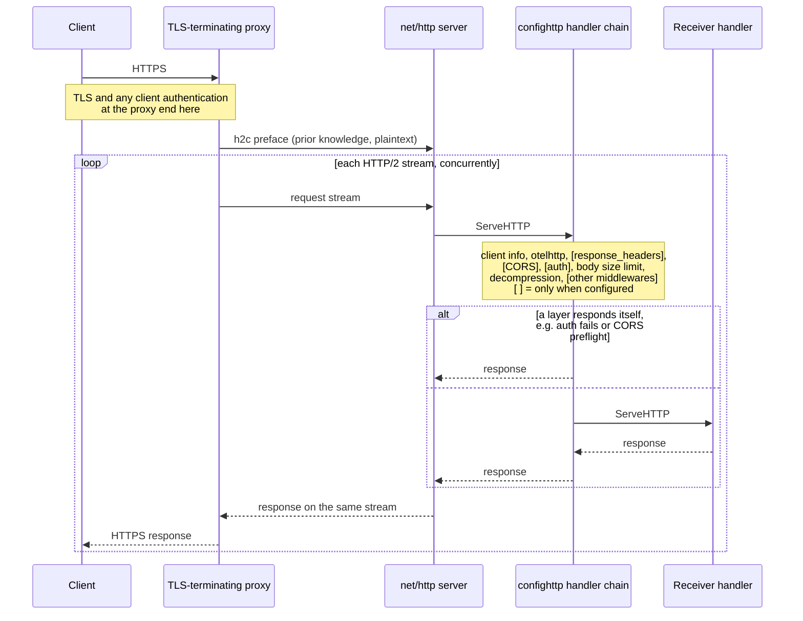

<!-- status autogenerated section -->
# HTTP/2 Cleartext Extension
| Status        |           |
| ------------- |-----------|
| Stability     | [development]  |
| Distributions | [] |
| Warnings      | [h2c is unencrypted and should only be used behind a TLS-terminating proxy on a trusted network.](#warnings) |
| Issues        | [](https://github.com/open-telemetry/opentelemetry-collector/issues?q=is%3Aopen+is%3Aissue+label%3Aextension%2Fh2c) [](https://github.com/open-telemetry/opentelemetry-collector/issues?q=is%3Aclosed+is%3Aissue+label%3Aextension%2Fh2c) |

[development]: https://github.com/open-telemetry/opentelemetry-collector/blob/main/docs/component-stability.md#development
<!-- end autogenerated section -->

This prototype adds cleartext HTTP/2 support to HTTP servers by configuring the
`h2c` HTTP server middleware extension.

```yaml
extensions:
  h2c:

receivers:
  otlp:
    protocols:
      http:
        endpoint: 0.0.0.0:4318
        middlewares:
          - id: h2c

service:
  extensions: [h2c]
```

## How h2c works

h2c is HTTP/2 over plaintext TCP, started with prior knowledge. Clients keep
using TLS to reach a proxy. The proxy terminates TLS and speaks h2c to the
Collector over a trusted network.

The extension only takes part when the server is built. Its handler wrapper
returns the handler unchanged, so it adds nothing to the request path. It also
asks the `confighttp` server to accept unencrypted HTTP/2 through
`http.Server.Protocols`.



After that, the Go standard library serves each HTTP/2 stream through the
server's handler chain, the same way it serves an HTTP/1.1 request. Streams on
one connection run concurrently. No h2c code runs per stream. A layer in the
chain can respond without calling the receiver, for example when configured
authentication fails or CORS answers a preflight request.



For each stream:

- When Collector `auth` is configured, it runs on its own for each stream that
  reaches it. A stream does not inherit the authenticated identity or other context values
  from other streams on the connection.
- With `include_metadata`, client metadata comes from that stream's headers.
- The body is decompressed according to its `Content-Encoding` when that
  encoding is enabled, and `max_request_body_size` applies to the received and
  decompressed body.
- The server records a separate HTTP server span.
- CORS and configured `response_headers` apply.

h2c connections belong to the receiver's server. When that server shuts down,
it sends HTTP/2 GOAWAY, refuses new streams, waits for in-flight streams and
then closes the connection.

The server keeps accepting HTTP/1.1 and, with TLS, HTTP/2.

## Request order

- **h2c does not change the request path.** Its wrapper returns the handler
  unchanged, so its position in `middlewares` does not matter. Other
  middlewares run in the order they are listed.
- **Middlewares run inside the `confighttp` layers.** They run after
  decompression and, when Collector `auth` is configured, authentication. They
  see the authenticated client and read the body through the size limit, so an
  oversized body fails while they read it. Some decoders can reject a body
  before middlewares run. When the request's `Content-Encoding` is enabled,
  they read the decoded body. A request that Collector authentication rejects
  never reaches them.
- **Collector authentication runs per request.** When `auth` is configured, it
  runs on its own for every HTTP/2 stream that reaches it, the same as an
  HTTP/1.1 request. Without it, the Collector does not authenticate requests,
  so the proxy must.
- **CORS runs before authentication.** When both CORS and Collector `auth` are
  configured, the CORS layer answers preflight `OPTIONS` requests without
  calling authentication. A successful preflight is not an authenticated
  request. Configured `response_headers` are set before authentication, so
  rejected requests still get them. Rejected requests also get CORS headers
  when their origin and method pass the CORS checks.
- **Streams are served concurrently.** The server handles streams on one
  connection at the same time, so a later stream can finish before an earlier
  one. Streams still share the connection and its limits, so one stream can
  slow others down.

## Protocol limitations

- **Prior knowledge only:** clients must start h2c with prior knowledge
  (RFC 9113 Section 3.3). The HTTP/1.1 `Upgrade: h2c` mechanism is deprecated by
  RFC 9113 and is not supported by the Go standard library. An upgrade request
  is served as a normal HTTP/1.1 request and the connection stays on HTTP/1.1.

## Warnings

h2c is plaintext. Use it only on a trusted network behind a TLS-terminating
proxy. Do not expose the listener directly to untrusted networks.

h2c does not authenticate or encrypt anything. If the proxy is where clients
are authenticated, make sure only the proxy can reach the listener. Anything
else that reaches it skips the proxy's checks, and the Collector authenticates
requests only when `auth` is configured.
