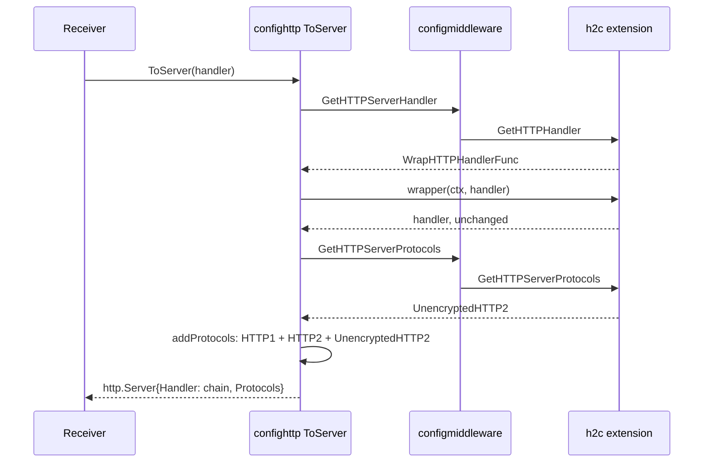
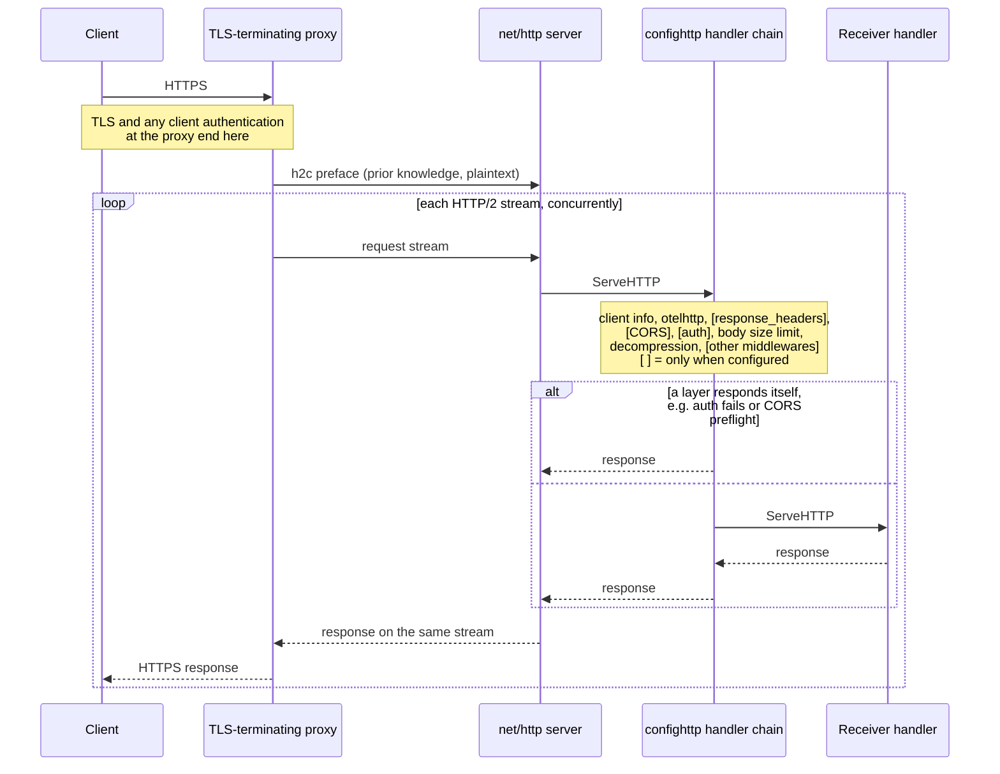

<!-- status autogenerated section -->
# HTTP/2 Cleartext Extension
| Status        |           |
| ------------- |-----------|
| Stability     | [development]  |
| Distributions | [] |
| Warnings      | [h2c is unencrypted and should only be used behind a TLS-terminating proxy on a trusted network.](#warnings) |
| Issues        | [](https://github.com/open-telemetry/opentelemetry-collector/issues?q=is%3Aopen+is%3Aissue+label%3Aextension%2Fh2c) [](https://github.com/open-telemetry/opentelemetry-collector/issues?q=is%3Aclosed+is%3Aissue+label%3Aextension%2Fh2c) |

[development]: https://github.com/open-telemetry/opentelemetry-collector/blob/main/docs/component-stability.md#development
<!-- end autogenerated section -->

The `h2c` HTTP server middleware extension adds cleartext HTTP/2 support to
HTTP servers.

h2c is HTTP/2 over plaintext TCP, started with prior knowledge[^prior-knowledge]. Clients keep
using TLS to reach a proxy. The proxy terminates TLS and speaks h2c to the
Collector over a trusted network.

```yaml
extensions:
  h2c:

receivers:
  otlp:
    protocols:
      http:
        endpoint: 0.0.0.0:4318
        middlewares:
          - id: h2c

service:
  extensions: [h2c]
```

## How it works

The extension configures an HTTP/2 server at start time to enable h2c for all requests by configuring the `confighttp` server to accept unencrypted HTTP/2 through `http.Server.Protocols`. Unlike with other extensions that typically wrap or modify the request, the h2c extension _must_ not modify the request and therefore leaves the server middleware unchanged.

See the diagram below for the sequence of interactions when setting up the HTTP/2 server with h2c support:



The Go standard library sends each HTTP/2 stream through the same handler chain
as an HTTP/1.1 request.



### Request order

As illustrated in the request-flow diagram above, each HTTP/2 stream passes
through these layers in order:

- **Client info and tracing:** With `include_metadata`, client metadata comes
  from the stream's headers. Each stream has its own HTTP server span.
- **Headers, CORS, and authentication:** Configured `response_headers` and CORS
  run before Collector `auth`, so auth rejections still carry configured
  response headers and any applicable CORS headers. CORS can answer a preflight
  `OPTIONS` request without calling auth. When configured, Collector `auth`
  checks each stream that reaches it. Streams do not share authenticated identities.
- **Body limits and middleware:** The server decodes the body when the request's
  `Content-Encoding` is enabled. `max_request_body_size` limits both the received
  and decoded body. Other middleware runs in list order after authentication
  (if configured) and decompression, regardless of where `h2c` appears in the
  list. Middleware reads a size-limited body; some decoders can reject it
  before middleware runs.

### Connection behavior

Streams can finish out of order, but they share the connection and its limits.

h2c connections belong to the receiver's server. When that server shuts down,
it sends `HTTP/2 GOAWAY`, refuses new streams, waits for in-flight streams and
then closes the connection.

The listener accepts both h2c and HTTP/1.1.

## TLS and validation

`h2c` and `tls` cannot be configured on the same HTTP server. For HTTP/2 over
TLS, configure `tls` without `h2c`. If you need both, use separate receivers or
listeners.

The Collector rejects the combination:

- **Before startup:** receivers that validate middleware references, such as
  the OTLP receiver, report it from `otelcol validate --config=config.yaml`.
- **At startup:** every `confighttp` server rejects it, including servers whose
  receiver does not validate middleware references.

The error names the middleware entry:

```text
receivers::otlp/edge::protocols::http::middlewares::0::id: middleware "h2c" requests unencrypted HTTP/2, but this listener requires TLS
```

mTLS ends at the proxy. The Collector receives no client certificate, so
`tls.client_ca_file` and any certificate-based client identity do not apply
to h2c connections. Authenticate clients at the proxy, configure Collector
`auth`, or both.

## Protocol limitations

- **Prior knowledge only:** clients must start h2c with prior knowledge
  (RFC 9113 Section 3.3)[^prior-knowledge]. The HTTP/1.1 `Upgrade: h2c` mechanism is deprecated by
  RFC 9113 and is not supported by the Go standard library. An upgrade request
  is served as a normal HTTP/1.1 request and the connection stays on HTTP/1.1.

## Warnings

h2c is plaintext. Use it only on a trusted network behind a TLS-terminating
proxy. Do not expose the listener directly to untrusted networks.

h2c does not authenticate or encrypt anything. If the proxy is where clients
are authenticated, make sure only the proxy can reach the listener. Anything
else that reaches it skips the proxy's checks, and the Collector authenticates
requests only when `auth` is configured.

[^prior-knowledge]: https://www.rfc-editor.org/rfc/rfc9113.html#section-3.3
